# CloudPulse — Comprehensive Technical Systems & Engineering Report

**Project Title:** CloudPulse: Multi-Cloud Infrastructure & Incident Management Platform  
**Target Architecture:** Containerized Microservices, Automated CI/CD, Infrastructure as Code, Kubernetes & Observability  
**Document Classification:** Engineering Delivery & Technical Architecture Report  
**Companion Presentation:** [CloudPulse_Presentation.pdf](../demo/CloudPulse_Presentation.pdf)  

---

## 1. Executive Summary & Problem Statement

### 1.1 The Operational Challenge
As modern software organizations scale their infrastructure across multiple public cloud providers (AWS, GCP, Azure), engineering and operations teams face critical operational blind spots:
- **Infrastructure Sprawl:** Assets are provisioned across disparate accounts and regions without a unified single pane of glass.
- **Uncontrolled Cloud Spending:** Platform leaders lack immediate visibility into estimated monthly expenditures across teams and providers.
- **Scattered Incident Response:** Infrastructure downtime and degradations are often tracked in isolation from the underlying parent infrastructure, delaying root-cause analysis and mean time to resolution (MTTR).

### 1.2 The CloudPulse Solution
**CloudPulse** is an internal cloud asset inventory and FinOps incident management platform engineered to solve these challenges. It provides engineering teams with:
1. **Centralized Asset Catalog:** A single registry to track virtual compute, managed databases, object storage, and Kubernetes clusters across cloud providers.
2. **FinOps Visibility:** Real-time rollups of monthly estimated cloud expenditures partitioned by provider, environment, and operational status.
3. **Linked Incident Tracking:** Direct correlation between infrastructure assets and active incident logs with cascade lifecycle management.
4. **End-to-End DevOps Architecture:** A production-grade implementation of containerization, automated testing, continuous integration/continuous delivery (CI/CD), vulnerability scanning, Infrastructure as Code (IaC), Kubernetes orchestration, and metrics observability.

---

## 2. System Architecture & High-Level Design

CloudPulse is designed as a decoupled, multi-tier system with clear separation of concerns across client, application, data, and infrastructure layers.

```text
Host Browser Client
       │
       ▼
[ Ingress Controller / AWS Elastic Load Balancer ]
       │
       ├── /api/*  ──> [ Backend API: FastAPI (Python 3.12, UID 10001) ]
       │                    │
       │                    ├── SQLAlchemy ORM Engine
       │                    ▼
       │               [ Database: PostgreSQL 16 Alpine ]
       │                    │
       │                    └── Persistent Storage Volume
       │
       └── /*      ──> [ Frontend Reverse Proxy: Nginx (Alpine, UID 101) ]
                            │
                            └── Serves Compiled React 18 Single-Page Application
```

### 2.1 Core Architectural Principles
- **Least-Privilege Security:** All containerized workloads execute as dedicated, non-root system users (`UID 10001` for the Python API, `UID 101` for the Nginx proxy).
- **Zero-Downtime Migration Safety:** Database schema migrations run as an isolated, one-off Job before backend replicas start serving live traffic, preventing schema race conditions.
- **Bounded Resource Isolation:** In Kubernetes, all microservices communicate internally through private `ClusterIP` services; public ingress is strictly controlled via an API gateway and reverse proxy.
- **Native Observability:** Telemetry collection is embedded natively into the application code rather than bolted on as an afterthought.

---

## 3. Backend API & Relational Database Design

### 3.1 Framework & API Design
The backend is developed in **Python 3.12** using the high-performance **FastAPI** asynchronous web framework. It enforces strict request and response schema validation using **Pydantic v2**.

#### Verified REST API Endpoints

| HTTP Method | Route | Description | Request/Response Validation | Status Code |
| :--- | :--- | :--- | :--- | :--- |
| `GET` | `/health` | Liveness probe confirming process responsiveness | Lightweight JSON: `{"status":"healthy"}` | `200 OK` |
| `GET` | `/ready` | Readiness probe confirming PostgreSQL connectivity | Executes active `SELECT 1` database query | `200 OK` / `503 Unavailable` |
| `GET` | `/metrics` | Native Prometheus telemetry exposition | OpenMetrics / Prometheus standard text format | `200 OK` |
| `GET` | `/api/resources` | List all tracked infrastructure assets | Supports filtering by `provider` and `status` | `200 OK` |
| `GET` | `/api/resources/stats`| Aggregate FinOps metrics | Sums total estimated monthly cost and status counts | `200 OK` |
| `GET` | `/api/resources/{id}` | Retrieve resource details | Includes nested array of linked incidents | `200 OK` / `404 Not Found` |
| `POST` | `/api/resources` | Register a new cloud resource | Validates non-negative cost and valid provider enums | `201 Created` / `422 Unprocessable` |
| `PUT` | `/api/resources/{id}` | Update resource attributes or operational state | Validates schema updates; returns updated record | `200 OK` / `404 Not Found` |
| `DELETE`| `/api/resources/{id}` | Decommission resource | Cascade deletes all associated incident logs | `204 No Content` / `404 Not Found` |
| `GET` | `/api/incidents` | List active and historical incidents | Supports filtering by `resource_id` and `status` | `200 OK` |
| `GET` | `/api/incidents/{id}` | Retrieve single incident log details | Returns full incident record | `200 OK` / `404 Not Found` |
| `POST` | `/api/incidents` | Log an incident against a parent resource | Enforces foreign key constraint existence | `201 Created` / `404 Not Found` |
| `PUT` | `/api/incidents/{id}` | Update incident severity or lifecycle state | Supports `investigating`, `mitigated`, `resolved` | `200 OK` / `404 Not Found` |
| `DELETE`| `/api/incidents/{id}` | Remove incident log | Removes incident record without affecting resource | `204 No Content` / `404 Not Found` |

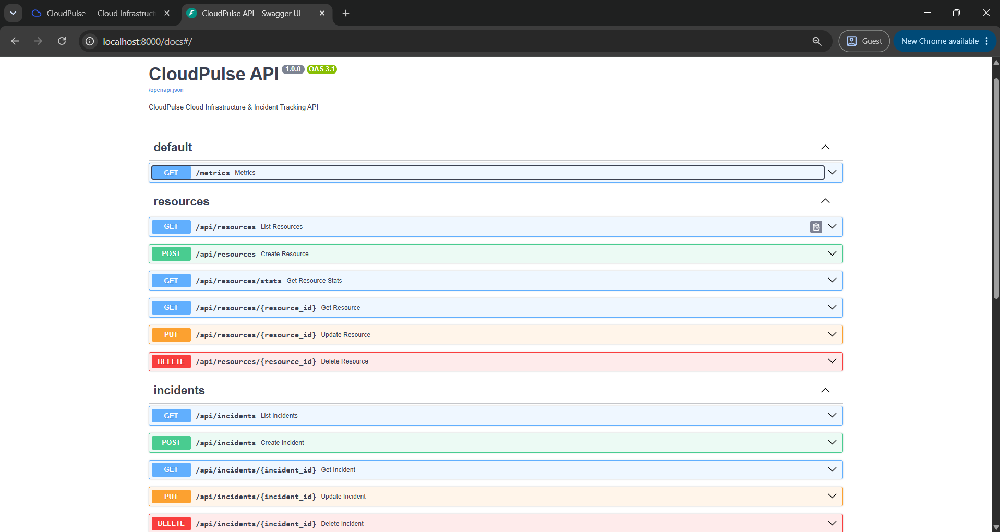  
*Figure 3.1: FastAPI interactive OpenAPI Swagger documentation interface displaying all verified CRUD and system endpoints.*

### 3.2 Relational Data Modeling & Migrations
The relational database is implemented in **PostgreSQL 16**. Data models are declared using **SQLAlchemy 2.0**:
- **`CloudResource` Model:** Captures `name`, `resource_type`, `cloud_provider` (`AWS`, `GCP`, `Azure`), `region`, `status` (`running`, `stopped`, `degraded`), and `cost_per_month`.
- **`IncidentLog` Model:** Captures `title`, `description`, `severity` (`low`, `medium`, `high`, `critical`), and `status`. It establishes a foreign key relationship with `cloud_resources.id` with `ondelete="CASCADE"`.
- **Alembic Migrations:** Database schema evolution is tracked declaratively in `backend/alembic/versions/`. Migrations are version-controlled, reproducible, and executed automatically on startup.

---

## 4. Frontend Architecture & User Interface Design

The frontend is a modern single-page dashboard built with **React 18** and **Vite**:
- **Design System:** Custom CSS design system with curated dark and light mode palettes, CSS grid/flexbox layouts, and responsive media queries.
- **State Management:** Reactive hooks (`useState`, `useEffect`) manage inventory state, active incident dialogs, search queries, and filter parameters.
- **Reverse Proxy Architecture:** The browser client calls relative endpoints (`/api/*`, `/health`), which are transparently proxied by Nginx to the backend service. This eliminates cross-origin resource sharing (CORS) security vulnerabilities in production.

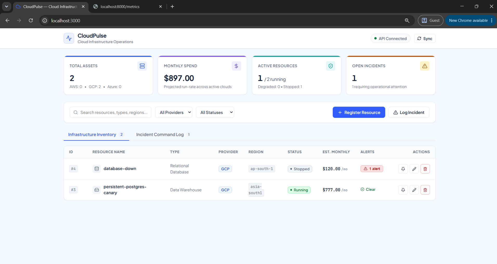  
*Figure 4.1: CloudPulse web dashboard displaying real-time FinOps KPI cards, cloud provider distribution, and asset inventory table.*

---

## 5. Automated Testing & Quality Assurance

### 5.1 Pytest Architecture
The automated test suite in `backend/tests/test_api.py` enforces code quality and behavioral correctness across the entire API surface.

```text
Pytest Execution Runner
       │
       ▼
[ In-Memory SQLite Test Fixture ]
       ├── Schema generated dynamically per session
       ├── 100% isolated from developer or production databases
       └── Clean teardown after execution
```

### 5.2 Test Coverage Highlights
The test suite consists of **14 comprehensive test cases**:
1. **Liveness & Readiness Probes:** Confirms `/health` returns `200 OK` and `/ready` verifies database connectivity.
2. **Resource CRUD Lifecycle:** Verifies complete creation, retrieval, query parameter filtering, updates, and deletion.
3. **Input Validation:** Confirms that negative costs or invalid cloud provider strings are rejected with HTTP `422 Unprocessable Entity`.
4. **Relationship Integrity:** Validates that incidents cannot be orphaned, require a valid parent resource, and are automatically deleted when the parent resource is decommissioned.
5. **Observability Output:** Verifies that `/metrics` emits valid Prometheus text output containing `http_requests_total`.

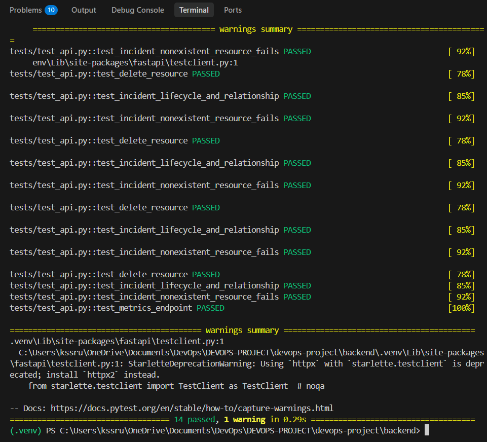  
*Figure 5.1: Pytest test runner executing 14 unit and integration tests against isolated SQLite fixture in 0.40s.*

---

## 6. Containerization & Local Orchestration

### 6.1 Multi-Stage Docker Architecture
Both application components utilize multi-stage Docker builds to produce lightweight, secure runtime containers:

- **Backend Container (`backend/Dockerfile`):**
  - Base Image: `python:3.12-slim`
  - Runs as dedicated non-root user `appuser` (`UID 10001`).
  - Caches dependency installations from `requirements.txt`.
  - Exposes port `8000` via Uvicorn.
- **Frontend Container (`frontend/Dockerfile`):**
  - *Build Stage:* Node.js 22 Alpine installs dependencies via `package-lock.json` and runs `npm run build` to generate the Vite production bundle.
  - *Runtime Stage:* `nginxinc/nginx-unprivileged:alpine`. Runs as unprivileged user `nginx` (`UID 101`).
  - Configured with custom `nginx.conf` providing SPA client routing and reverse-proxying `/api/` calls to the backend.

### 6.2 Docker Compose Orchestration
The local development environment is orchestrated via `docker-compose.yml`:
- **Dependency Ordering:** `migrate` waits for `db` to pass health checks; `backend` waits for `migrate` to complete successfully; `frontend` waits for `backend` to become healthy.
- **Data Persistence:** Database data is stored in the named Docker volume `cloudpulse_postgres_data`, ensuring persistence across stack restarts.
- **Network Isolation:** All containers communicate across a dedicated bridge network (`cloudpulse_net`).

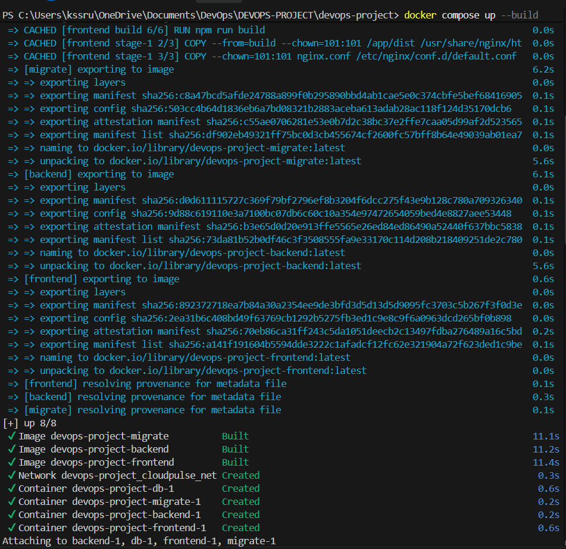  
*Figure 6.1: Docker Compose building and launching the three-tier application stack with ordered service dependencies.*

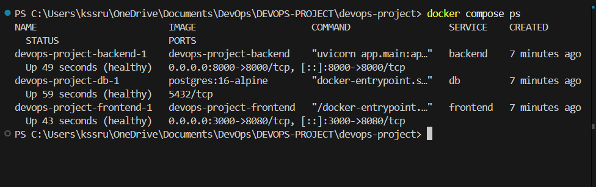  
*Figure 6.2: Docker Compose service status showing database, backend, and frontend containers reporting healthy state.*

---

## 7. Continuous Integration & Delivery (CI/CD)

The automated delivery pipeline is implemented via GitHub Actions in `.github/workflows/ci-cd.yml`. It acts as an automated quality gate and container publishing engine.

```text
Backend Tests (Pytest) ───────┐
Frontend Build (Vite) ────────┤
Terraform Validation ─────────┤
Helm & Kubeconform ───────────┤── 5 Parallel Validation Jobs
Monitoring Validation ────────┘          │
                                         ▼ (needs: backend-tests, frontend-build)
                                    Docker Build
                                         │
                                         ▼ (needs: docker-build)
                                   Trivy Security Scan
                                         │
                                         ▼ (needs: all validations + Docker + Trivy)
                                   Publish Images to GHCR (main branch only)
```

### 7.1 Pipeline Stages & Quality Gates
1. **`backend-tests`:** Pinned Python 3.12 runner executes `pytest -v`.
2. **`frontend-build`:** Pinned Node.js 22 runner executes `npm ci` and `npm run build`.
3. **`terraform-validation`:** Pinned Terraform v1.9.8 validates formatting (`fmt -check`), initializes plugins (`init -backend=false`), and validates syntax (`validate`).
4. **`helm-k8s-validation`:** Pinned Helm v3.16.4 and Kubeconform v0.6.7 lint the chart, render templates, validate schemas offline against official Kubernetes specifications, and assert architectural requirements (2 replicas, ClusterIP services, Ingress paths).
5. **`monitoring-validation`:** Validates Prometheus YAML targets, Grafana datasource URLs, and dashboard JSON schemas.
6. **`docker-build`:** Compiles images using Docker Buildx and GitHub Actions layer caching; exports tar archives for downstream stages.
7. **`trivy-security-scan`:** Scans exported container images for OS and application vulnerabilities.
8. **`publish-ghcr`:** Authenticates to GitHub Container Registry using `secrets.GITHUB_TOKEN` and publishes versioned images tagged with the 40-character Git commit SHA (`${{ github.sha }}`). Floating `latest` tags are prohibited.

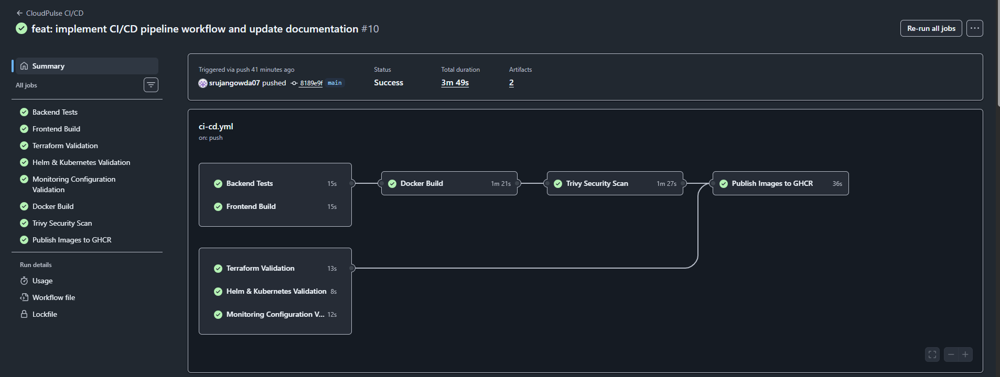  
*Figure 7.1: GitHub Actions CI/CD execution pipeline displaying successful parallel validation, build, scan, and publish jobs.*

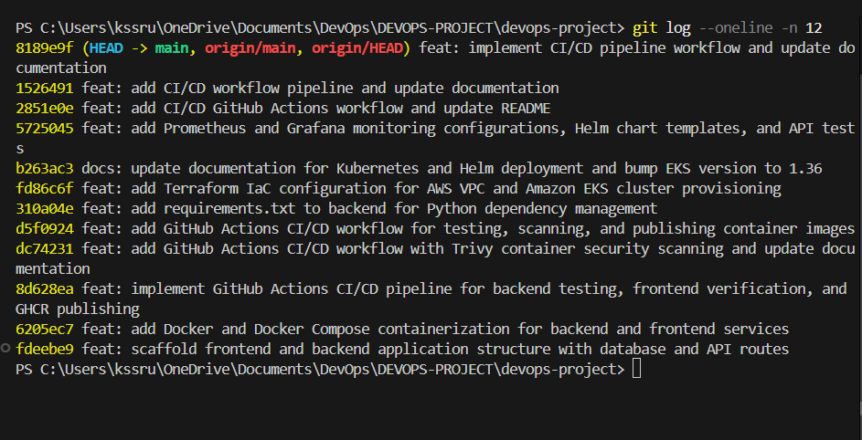  
*Figure 7.2: Git commit history illustrating clean commit discipline and traceability.*

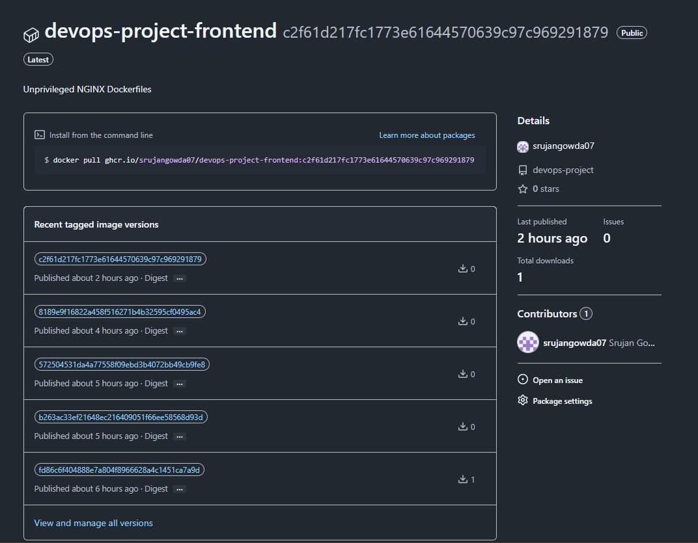  
*Figure 7.3: GitHub Packages (GHCR) repository for devops-project-frontend showing immutable commit-SHA tagged image releases.*

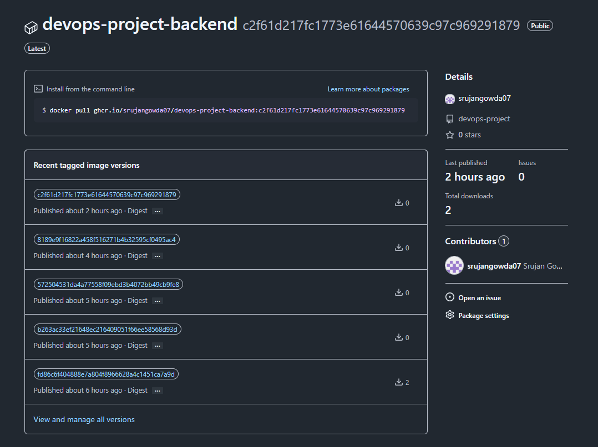  
*Figure 7.4: GitHub Packages (GHCR) repository for devops-project-backend showing immutable commit-SHA tagged image releases.*

---

## 8. DevSecOps & Vulnerability Management

### 8.1 Automated Container Scanning (Aqua Security Trivy)
Security scanning is integrated directly into the CI/CD pipeline using `aquasecurity/trivy-action`:
- **Scope:** Scans both `devops-project-backend` and `devops-project-frontend` images.
- **Coverage:** Inspects base OS packages (Alpine and Debian slim) and application dependencies (Python wheels and npm packages).
- **Enforcement Policy:** The pipeline is configured with `severity: 'HIGH,CRITICAL'` and `exit-code: 1`, immediately halting container publishing if actionable vulnerabilities are detected.
- **Audit Reports:** Generates machine-readable SARIF reports uploaded as workflow artifacts for security compliance.

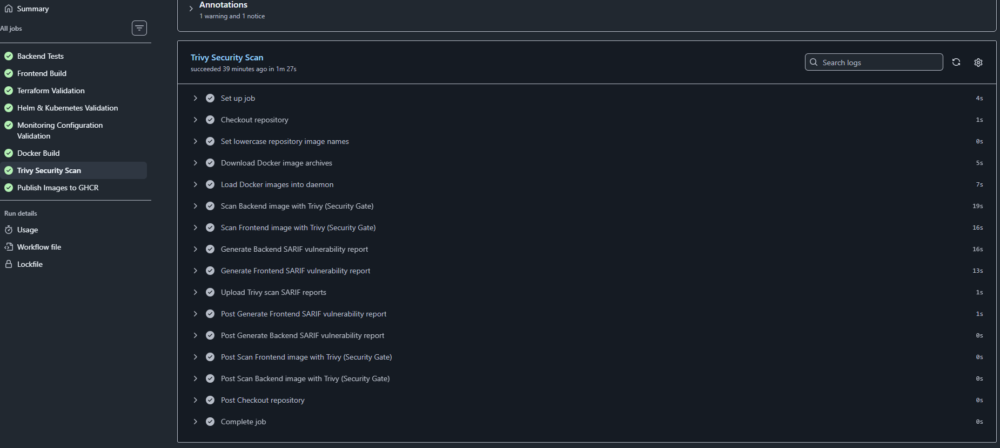  
*Figure 8.1: Aqua Security Trivy terminal execution scanning backend and frontend container images for CVE vulnerabilities.*

---

## 9. Infrastructure as Code (Terraform & AWS EKS)

The cloud runtime infrastructure is defined declaratively using HashiCorp Terraform in `terraform/`.

```text
AWS VPC (10.0.0.0/16) in ap-south-1
 ├── Internet Gateway (IGW)
 ├── Route Table (0.0.0.0/0 -> IGW)
 ├── Public Subnet 1: 10.0.1.0/24 (ap-south-1a)
 ├── Public Subnet 2: 10.0.2.0/24 (ap-south-1b)
 └── Amazon EKS Cluster: cloudpulse-eks (Kubernetes 1.36)
      └── Managed Node Group: cloudpulse-eks-node-group (t3.small instances)
```

### 9.1 Network & Compute Architecture
- **Multi-AZ High Availability:** Public subnets span two distinct Availability Zones (`ap-south-1a` and `ap-south-1b`) tagged with `kubernetes.io/role/elb = "1"` for Kubernetes load balancer auto-discovery.
- **Cost Optimization:** Utilizes direct Internet Gateway routing for public worker nodes, eliminating costly AWS NAT Gateways and saving over ~$32/month in baseline network charges.
- **Lifecycle Support Optimization:** Deploys Amazon EKS Kubernetes version `1.36`, ensuring active Standard Support and avoiding AWS's 6x extended support price surcharge.
- **Conservative Compute Sizing:** EC2 worker nodes run on `t3.small` instances (`min = 1`, `desired = 1`, `max = 2`) running the Amazon Linux 2023 EKS-optimized AMI.

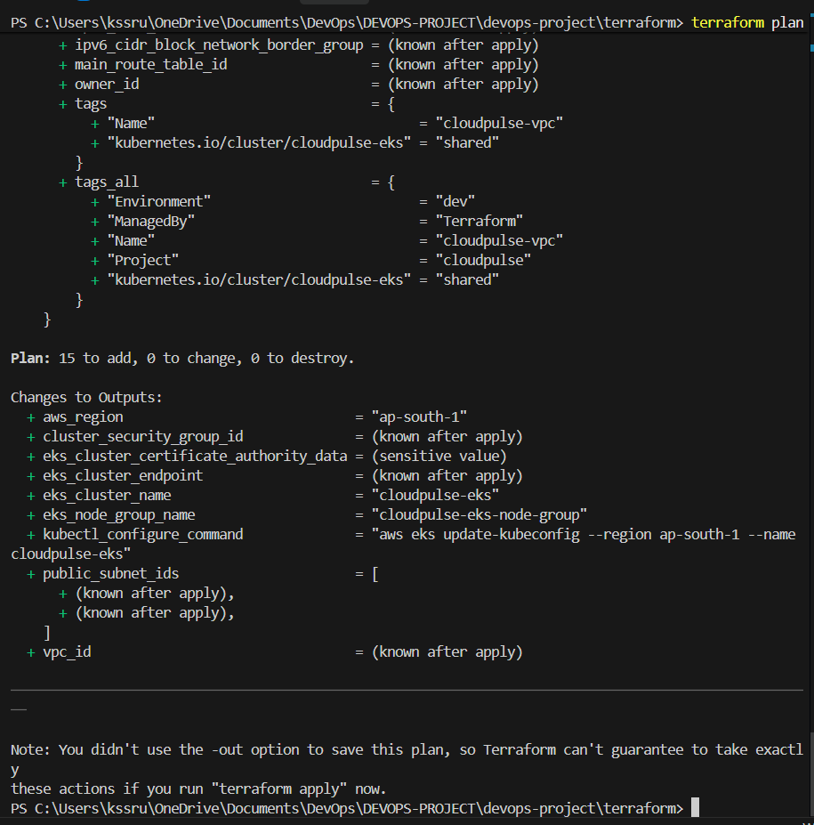  
*Figure 9.1: Terraform plan execution output displaying declarative AWS resource plan.*

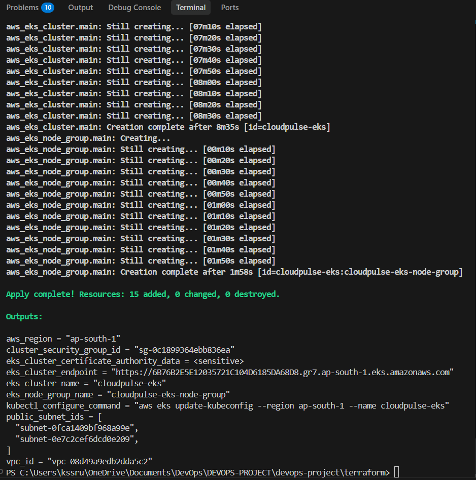  
*Figure 9.2: Terraform apply output confirming successful provisioning of AWS VPC, subnets, IGW, and EKS cluster.*

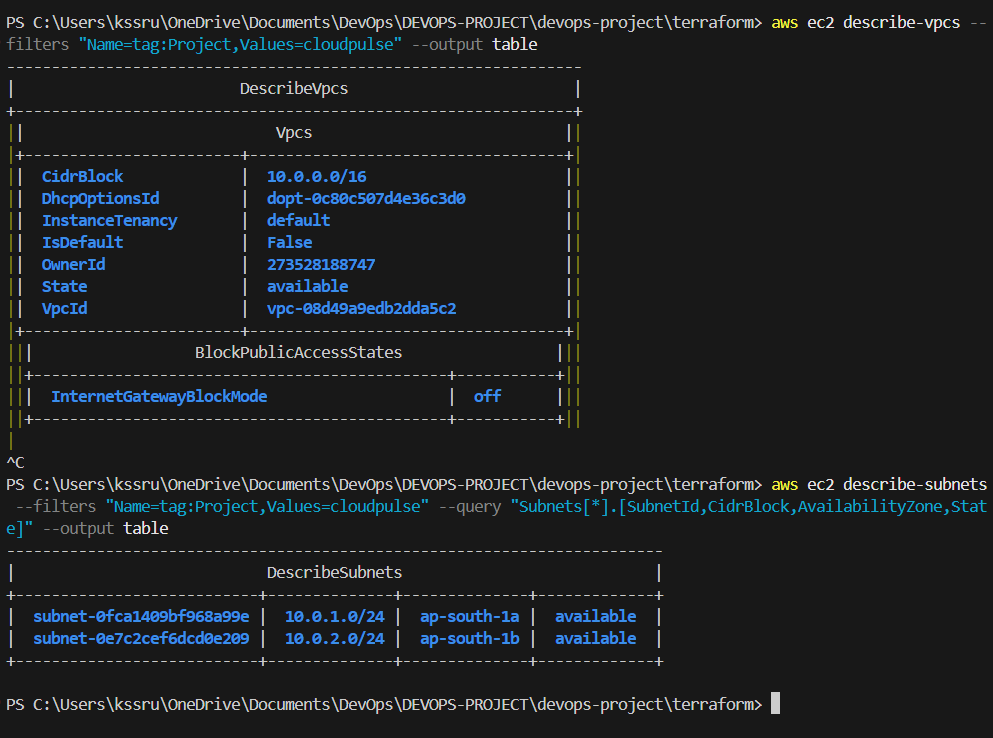  
*Figure 9.3: AWS CLI terminal output verifying active VPC and dual-AZ public subnet configuration.*

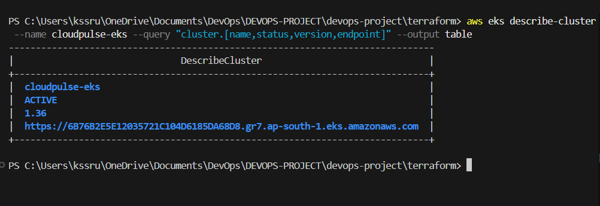  
*Figure 9.4: AWS CLI terminal output confirming Amazon EKS cluster status is ACTIVE on Kubernetes 1.36.*

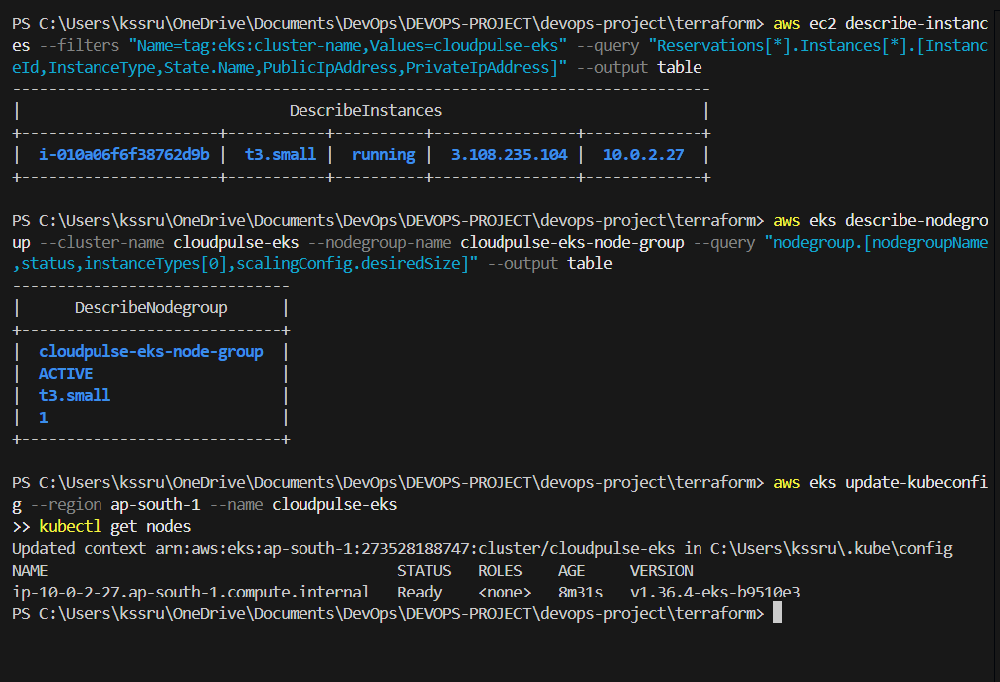  
*Figure 9.5: AWS CLI terminal output showing healthy t3.small EC2 worker instances attached to the EKS managed node group.*

---

## 10. Kubernetes Orchestration & Helm Packaging

The application workloads are packaged and managed via a dedicated Helm chart located in `helm/cloudpulse/`.

### 10.1 Workload Architecture
- **Backend Deployment:** Configured with **2 replicas** for high availability, HTTP liveness probes on `/health`, readiness probes on `/ready`, and non-root security context (`UID 10001`).
- **Frontend Deployment:** Configured with **2 replicas**, HTTP probes on `/`, and unprivileged non-root security context (`UID 101`).
- **Database Deployment:** Single-replica PostgreSQL 16 container with `Recreate` deployment strategy.
- **Database Migration Job:** Executed via a standalone Kubernetes `Job` (`cloudpulse-migration`) running `alembic upgrade head`, ensuring migrations complete before backend pods serve traffic.
- **Service Mesh & Exposure:** Internal services communicate over private `ClusterIP` networks. External public traffic is routed via Nginx Ingress or provisioned AWS Elastic Load Balancers (ELBs).

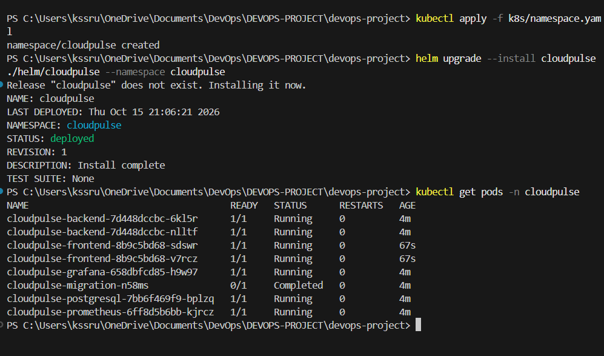  
*Figure 10.1: Kubectl terminal output verifying 2-replica backend, 2-replica frontend, database, and monitoring pods in Running state.*

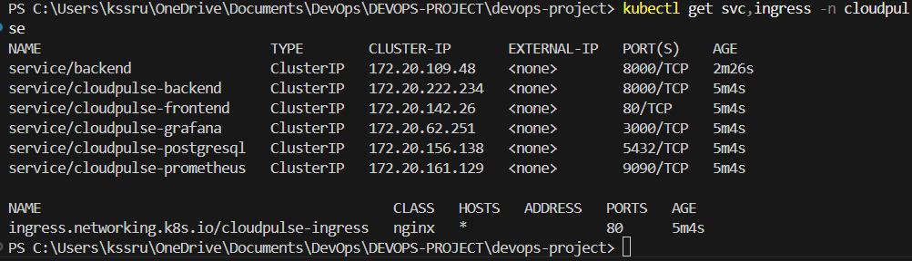  
*Figure 10.2: Kubectl get svc and ingress output showing ClusterIP service bindings and Ingress host routing.*

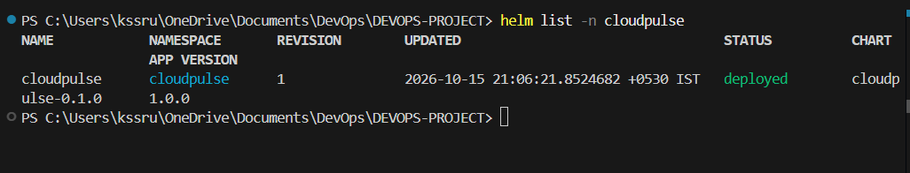  
*Figure 10.3: Helm list terminal output verifying cloudpulse release successfully deployed.*

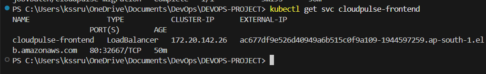  
*Figure 10.4: Kubectl detailed service inspection confirming port mappings for application, database, and telemetry services.*

---

## 11. Full-Stack Observability & Telemetry

CloudPulse deploys an integrated observability stack with zero manual dashboard configuration:

```text
FastAPI Backend (:8000/metrics)
       │
       ▼ (Prometheus scrapes every 15s via CoreDNS)
[ Prometheus Server (:9090) ]
       │
       ▼ (Prometheus Datasource)
[ Grafana Dashboard (:3000) ]
       │
       └── Live Visual Dashboards (Throughput, Latency, Errors, Database Health)
```

### 11.1 Telemetry Collection & Dashboards
- **Instrumentation:** The backend uses `prometheus-fastapi-instrumentator` to emit metrics following open Prometheus text format standards.
- **Prometheus Scraping:** An in-cluster Prometheus deployment automatically targets `cloudpulse-backend:8000/metrics`.
- **Automated Grafana Provisioning:** Grafana is configured via Kubernetes ConfigMaps to automatically provision the Prometheus datasource and load the pre-configured `CloudPulse Application Observability` dashboard upon startup.
- **Key Visualized Metrics:**
  - `up{job="cloudpulse-backend"}`: Real-time service health.
  - `http_requests_total`: Throughput partitioned by handler, HTTP method, and response status.
  - `http_request_duration_seconds_bucket`: Latency percentiles (p50, p90, p95).
  - Server error rates (HTTP 5xx distribution).

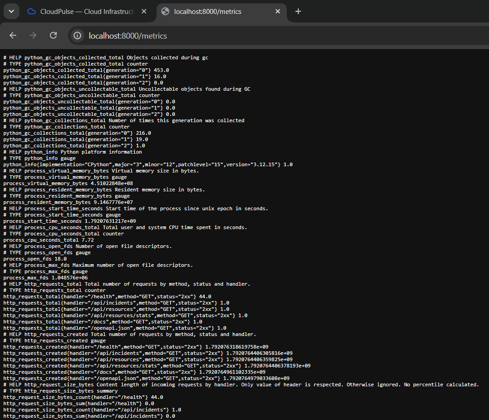  
*Figure 11.1: Raw Prometheus telemetry stream emitted by FastAPI backend at /metrics.*

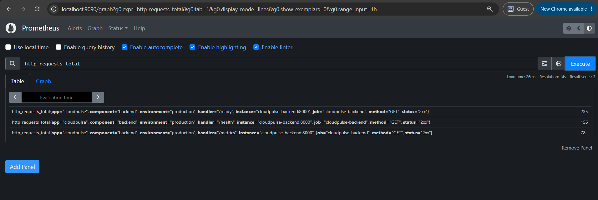  
*Figure 11.2: Prometheus dashboard showing cloudpulse-backend active scrape target reporting healthy UP status.*

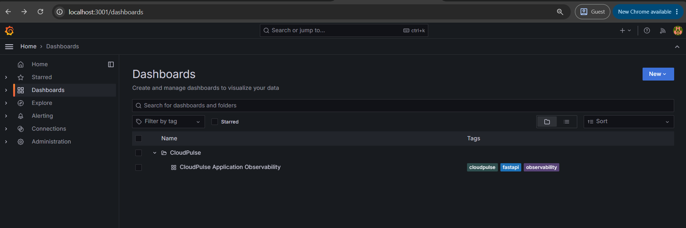  
*Figure 11.3: Pre-provisioned Grafana CloudPulse dashboard rendering live request rate, p95 latency, error rate, and DB health.*

---

## 12. Infrastructure Decommissioning & Cost Control

To eliminate unintended AWS billing after project evaluation, all provisioned cloud infrastructure was decommissioned:

```bash
# 1. Uninstall Helm release
helm uninstall cloudpulse -n cloudpulse

# 2. Delete Kubernetes namespace
kubectl delete namespace cloudpulse

# 3. Destroy all AWS cloud infrastructure
cd terraform
terraform destroy -auto-approve
cd ..
```

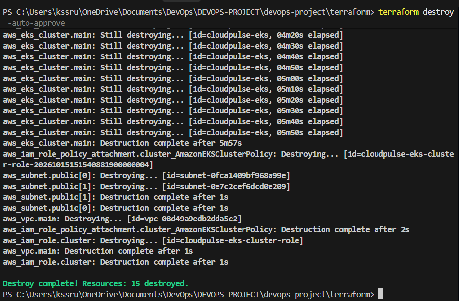  
*Figure 12.1: Terraform destroy output confirming all AWS cloud resources were cleanly deleted with 0 active objects remaining.*

### Post-Decommissioning Verification:
The AWS account was verified via the AWS CLI to confirm that:
- **0** EC2 instances remain active or running.
- **0** Amazon EKS clusters exist.
- **0** Elastic Load Balancers (ELBs) exist.
- **0** CloudPulse VPCs exist.

---

## 13. Production Readiness & Future Roadmap

### 13.1 Current Maturity State
The CloudPulse platform represents a verified, production-style DevOps implementation. Containerization, automated quality gates, security scanning, infrastructure definitions, and observability pipelines are fully implemented and verified.

### 13.2 Recommended Future Enhancements
1. **Dynamic Cloud Provider Ingestion:** Integrate optional background workers (e.g., Celery or AWS Lambda) with read-only AWS IAM and GCP Service Account credentials to automatically ingest cloud inventory.
2. **Persistent Storage for In-Cluster PostgreSQL:** On AWS EKS, install the AWS EBS CSI Driver (`aws-ebs-csi-driver`) and configure a dynamic `gp3` StorageClass to back the PostgreSQL PersistentVolumeClaim.
3. **Secret Management:** Replace Kubernetes base64 Secrets with external secret stores such as AWS Secrets Manager or HashiCorp Vault using the External Secrets Operator (ESO).
